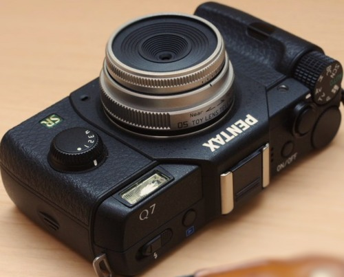

# PENTAX Q7 펌웨어 1.01 분석

리코가 배포한 Q7 펌웨어 `fwdc603p.bin`에서 프로그램을 꺼내 압축을 풀고, 카메라가 업데이트를 설치하고 색을 처리하고 초점을 맞추고 메뉴 글자를 그리는 코드를 추적한 연구 기록입니다.

**문서는 여기서 읽습니다 → [https://yunhyok.github.io/pentax-q7-firmware-analysis/](https://yunhyok.github.io/pentax-q7-firmware-analysis/)**



<sub>사진: Tomidaooooooo, [CC BY 4.0](https://creativecommons.org/licenses/by/4.0/), [Wikimedia Commons](https://commons.wikimedia.org/wiki/File:Pentax_Q7_jp475.png) (형식 변환·크기 축소). 자세한 출처는 [assets/photos/CREDITS.md](assets/photos/CREDITS.md).</sub>

> **먼저 알아 둘 점.** 모든 분석은 PC에서 했습니다. 수정한 펌웨어를 카메라에 설치하거나 실행한 적이 없습니다. 이 저장소에는 카메라에 넣을 수 있는 펌웨어가 없고, 원본 펌웨어와 거기서 꺼낸 프로그램·심볼 목록·디컴파일 원문도 없습니다.

## 무엇을 알아냈나

세 기종(K-3 Mark III, K-3 II, Q7)을 같은 네 가지 질문으로 조사합니다. Q7에서 온 지점은 다음과 같습니다.

| 질문 | 알아낸 것 | 아직 모르는 것 |
|---|---|---|
| 펌웨어를 고쳐서 다시 만들 수 있는가 | 압축 448블록을 풀었다 다시 압축하면 배포본과 바이트까지 같음. 색 행렬 함수를 C로 다시 짜서 원래 자리에 넣은 파일 생성. 업데이트 설치 코드의 앞부분 추적 | 카메라가 수정본을 받아들이는지, 부팅하는지, NAND에 실제로 기록되는 과정 |
| 카메라의 색은 어떻게 만들어지는가 | 색 행렬이 영상 처리 회로의 레지스터로 가는 조건, HDR 촬영의 마지막 처리 단계 | 실제 픽셀 처리 결과, 일반 촬영과 HDR의 차이 |
| AF 동작을 바꿀 수 있는가 | 렌즈 명령과 응답의 흐름, “명령 성공”과 “이동 완료”의 판정 구분 | 실제 렌즈 통신·모터 이동·초점 정확도 |
| K-3 Mark III의 화면을 옮길 수 있는가 | 색공간 메뉴 화면의 선택·확정·취소부터 글꼴 로딩과 글자 픽셀까지 | 실제 버튼 입력에서 LCD까지, 실제 색 |

세 기종을 나란히 비교한 현황은 [세 기종 연구 본부](https://yunhyok.github.io/pentax-k3iii-firmware-analysis/analysis/research-program.html)에 있습니다.

## 문서 안내

주제마다 안내 문서가 있습니다. 안내 문서에서 전체 그림을 본 뒤 세부 문서로 들어가면 읽기 쉽습니다.

| 주제 | 안내 문서 |
|---|---|
| 시작하기 | [개요](https://yunhyok.github.io/pentax-q7-firmware-analysis/) · [펌웨어 파일 구조](https://yunhyok.github.io/pentax-q7-firmware-analysis/structure-report.html) · [압축 복원과 주요 함수 300개](https://yunhyok.github.io/pentax-q7-firmware-analysis/deep-report.html) · [용어집](https://yunhyok.github.io/pentax-q7-firmware-analysis/glossary.html) |
| 업데이트와 재패킹 | [업데이트·재패킹 안내](https://yunhyok.github.io/pentax-q7-firmware-analysis/guide-update.html) |
| 색 처리와 HDR | [색 처리·HDR 안내](https://yunhyok.github.io/pentax-q7-firmware-analysis/guide-color.html) |
| AF와 렌즈 제어 | [AF·렌즈 안내](https://yunhyok.github.io/pentax-q7-firmware-analysis/guide-af.html) |
| 화면과 글꼴 | [화면·글꼴 안내](https://yunhyok.github.io/pentax-q7-firmware-analysis/guide-ui.html) |

문서는 결과마다 얼마나 확실한지를 네 가지로 표시합니다: **확인**(원본 코드를 PC 에뮬레이터에서 실행해 관측), **정적 분석**(코드를 읽어서 판단), **모델**(실물 대신 넣은 값), **미확인**. 자세한 뜻은 [개요의 “검증 수준 읽는 법”](https://yunhyok.github.io/pentax-q7-firmware-analysis/#levels)에 있습니다.

GitHub에서 HTML 파일을 열면 소스가 보입니다. 오프라인으로 읽으려면 저장소를 내려받아 `index.html`을 브라우저로 여세요.

## 직접 확인하기

펌웨어 없이, 공개된 문서·근거 파일·도구가 서로 맞는지 검사합니다. Python 3.10 이상과 표준 라이브러리만 있으면 됩니다.

```bash
python -m unittest discover -s tests -v
python tools/pentax_lz.py --self-test
python tools/verify_report.py
```

리코 공식 사이트에서 받은 `fwdc603p.bin`이 있으면 공개한 측정값 전체를 다시 계산해 비교할 수 있습니다. 출력 경로는 새 경로여야 합니다.

```bash
python tools/inspect_q7.py fwdc603p.bin --output .private/recheck.json --private-dir .private/recheck-elf
python tools/verify_report.py --firmware fwdc603p.bin
```

디컴파일까지 다시 하려면 Ghidra 12.1과 JDK 21이, 원본 명령 재실행에는 angr 10.0.5가 필요합니다. 파일 오프셋과 ELF 주소는 다른 값이며, 정적 분석 결과를 카메라 실행 결과로 읽으면 안 됩니다.

## 문서를 고치는 방법

루트의 `*-report.html`과 `index.html`은 생성물입니다. 직접 고치지 않습니다.

| 고칠 것 | 위치 |
|---|---|
| 본문 글과 그림 | `analysis/<이름>-template.html` |
| 근거 파일에서 뽑는 표와 수치 | `tools/build_<이름>_report.py` |
| 문서 목록과 순서, 상단 메뉴 | `site-map.json` |
| 안내 문서와 용어집 | 루트의 `guide-*.html`, `glossary.html` (직접 편집) |

고친 뒤에는 전체를 다시 만들고 검사합니다.

```bash
python tools/build_all.py
python tools/verify_report.py
```

## 저장소 구성

| 경로 | 내용 |
|---|---|
| `index.html`, `*-report.html`, `guide-*.html`, `glossary.html` | 분석 문서 |
| `analysis/*-template.html` | 문서 템플릿 |
| `analysis/*.json` | 측정 결과(근거 파일). `analysis/hq-status.json`은 연구 목표별 상태 기록 |
| `tools/` | 분석 도구(`inspect_q7.py`, `check_*.py`), 근거 검사(`verify_*.py`), 문서 생성(`build_*.py`) |
| `source/reconstructed/` | 직접 작성한 재구성 C 코드 |
| `tests/` | 단위 테스트 |
| `assets/` | 문서 스타일과 사진 |
| `docs/audit/` | 문서 검수 기록 (무엇을 확인했고 무엇을 고쳤는지, 판단이 필요한 항목) |
| `docs/releases/` | 릴리스 노트 |

## 릴리스

[릴리스 목록](https://github.com/yunhyok/pentax-q7-firmware-analysis/releases)에서 문서와 도구를 묶은 ZIP과 SHA-256을 받을 수 있습니다. `docs/releases/<태그>.md`를 main에 병합하면 릴리스 워크플로가 검사를 돌린 뒤 릴리스를 만듭니다.

## 공개 범위

공개 자료는 직접 작성한 분석 도구, 측정 결과, 문서입니다. 원본 BIN, 추출한 ELF, 전체 심볼 목록, 디컴파일 원문은 공개하지 않습니다. 리코의 공식 프로젝트가 아닌 독립 분석 기록입니다. 사진의 라이선스는 [assets/photos/CREDITS.md](assets/photos/CREDITS.md)에 따로 적었습니다.

## 관련 저장소

- [K-3 Mark III 펌웨어 분석](https://github.com/yunhyok/pentax-k3iii-firmware-analysis) — 세 기종 연구 본부와 Lightroom 색 프로파일 연구 포함
- [K-3 II 펌웨어 분석](https://github.com/yunhyok/pentax-k3ii-firmware-analysis)
